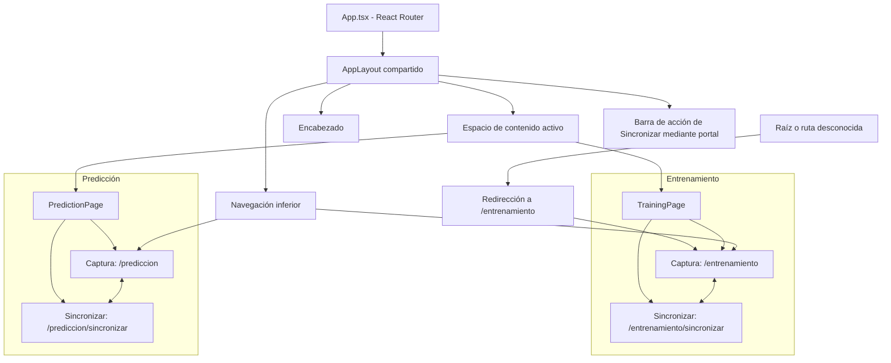

# Arquitectura de interfaz y sincronización — ML Sensores

## Estado y alcance

Arquitectura aprobada e implementada. La Fase 3 está completada y validada en Android: navegación, tema claro, captura, guardado SQLite y listados locales funcionan de extremo a extremo. Las fases 1 y 2 también están completadas y SQLite está validado según confirmación del usuario.

La arquitectura de Fase 3 se amplió con participantes (5-B) y conectividad/sincronización (5-C a 5-D.3), completadas y validadas por el usuario en Xiaomi 11T. Las vistas «Sincronizar» muestran exclusivamente pendientes de su módulo y permiten envío individual/masivo y eliminación local. FastAPI está desplegada en Render y el almacenamiento en MongoDB fue verificado por el usuario. Dataset definitivo, entrenamiento del modelo e inferencia permanecen pendientes.

## 1. Inventario actual y reutilización

| Archivo | Responsabilidad actual | Uso |
|---|---|---|
| `src/main.tsx` | Monta React con `StrictMode`, `BrowserRouter` e importa `index.css`. | Entrada de la aplicación. |
| `src/App.tsx` | Declara las cuatro rutas y la redirección de rutas desconocidas. | Mapa de navegación validado. |
| `src/hooks/useSensorCapture.ts` | Encapsula la sesión, eventos, temporización y resultados. | Consumido por las vistas Captura de ambos módulos; validado. |
| `src/hooks/useCaptureSave.ts` | Coordina validación, UUID, fecha, tipo/actividad, guardado y reintento. | Guardado automático compartido; validado. |
| `src/hooks/useRecordSummaries.ts` | Consulta resúmenes por tipo, carga, error y reintento. | Listados de las vistas Sincronizar; validado. |
| `src/hooks/useParticipants.ts` | Consulta, selección, creación y eliminación de participantes con confirmación. | Captura de Entrenamiento. |
| `src/hooks/useRecordSync.ts` | Envío individual/masivo, confirmación de eliminación, errores y refresco; observa bloqueo global. | Vistas Sincronizar de ambos módulos. |
| `src/services/database.ts` | Conexión/cola compartida, migración v2, registros, participantes, resúmenes y eliminación condicionada. | Único servicio de persistencia local para ambas páginas. |
| `src/services/sync.ts` | Elegibilidad, transformación explícita, lotes de hasta cinco, validación de respuesta y marcado local. | Motor común para envíos individuales y masivos de ambos tipos. |
| `src/services/recordOperations.ts` | Exclusión mutua observable de sincronizaciones y eliminación. | Compartido entre módulos y conservado durante la navegación. |
| `src/services/api.ts`, `src/config/api.ts` | Transporte `CapacitorHttp`, errores/timeouts y configuración HTTPS. | FastAPI en Render; sin conexión directa a MongoDB desde la app. |
| `src/types/sensores.ts` | `EstadoCaptura`, `MedicionSensor`, `ResultadoCaptura` con mediciones completas. | Contratos del hook y de los componentes de captura. |
| `src/types/records.ts` | `Actividad`, `TipoRegistro`, `EstadoSync`, `Medicion`, `Registro`, `RegistroResumen` y `Participante`. | Contrato común; `Medicion` reutiliza `MedicionCompleta`, sin ejes nulos. |
| `src/types/sync.ts` | Solicitudes y resultados HTTP de Entrenamiento/Predicción. | Contrato independiente de los campos internos SQLite. |
| `src/index.css`, `src/assets/` | Estilos y recursos existentes. | Tema claro y presentación; sin un segundo sistema de temas. |

La estructura de páginas, layouts, componentes compartidos, hooks y servicios está implementada. React Router está declarado en las dependencias. Este repositorio contiene el cliente HTTP; la implementación de FastAPI pertenece al backend externo.

`DatabaseTest.tsx`, `CaptureTest.tsx` y `App.css` fueron eliminados en la tarea 3.9-A; no forman parte de la arquitectura actual.

El diseño persistente de registros sigue siendo el de [SQLITE_DESIGN.md](SQLITE_DESIGN.md); esta arquitectura no redefine su tabla ni sus restricciones. El estado actualizado de validación se registra en `WORK_STATUS.md`.

## 2. Páginas y rutas aprobadas

Hay solo **dos páginas principales**, cada una con dos vistas internas:

| Ruta | Página | Vista |
|---|---|---|
| `/entrenamiento` | `TrainingPage` | Captura |
| `/entrenamiento/sincronizar` | `TrainingPage` | Sincronizar |
| `/prediccion` | `PredictionPage` | Captura |
| `/prediccion/sincronizar` | `PredictionPage` | Sincronizar |

- `App.tsx` declara explícitamente las cuatro rutas y la redirección de cualquier ruta desconocida a `/entrenamiento`, incluyendo `/`.
- React Router es la fuente de verdad para la navegación. La vista activa procede de la ruta, evitando un estado local de pestaña que pueda contradecir la URL.
- La navegación inferior cambia entre Entrenamiento y Predicción. Los controles internos de cada página enlazan sus vistas Captura y Sincronizar.
- `AppLayout` comparte encabezado, navegación inferior y contenido central desplazable. El contenedor `#app-action-bar` se sitúa entre contenido y navegación; `RecordsSyncView` monta allí el botón masivo mediante `createPortal`. La barra reserva espacio en el layout y no tapa las últimas tarjetas; se oculta al desmontar la vista. Los insets de área segura se conservan.
- Las vistas internas se componen con componentes reutilizables; no existen cuatro páginas principales ni rutas adicionales para tarjetas, resultados o pruebas técnicas.
- La integración con el historial de Android fue validada en la tarea 3.9-B. Las rutas lógicas de esta tabla son el contrato aprobado.

### Diagrama de navegación



## 3. Organización implementada

La estructura se creó progresivamente, con una responsabilidad concreta y un consumidor por archivo. No se crearon archivos vacíos ni se duplicaron servicios o tipos.

```text
src/
├── main.tsx                         # Entrada de React con BrowserRouter
├── App.tsx                          # Mapa de rutas
├── index.css                        # Tema claro y estilos compartidos
├── assets/
├── pages/
│   ├── TrainingPage.tsx             # Captura y Sincronizar de entrenamiento
│   └── PredictionPage.tsx           # Captura y Sincronizar de predicción
├── layouts/
│   └── AppLayout.tsx
├── shared/
│   ├── Header.tsx
│   └── BottomNavigation.tsx
├── components/
│   ├── capture/
│   │   ├── CaptureClock.tsx
│   │   ├── ActivitySelector.tsx
│   │   ├── ParticipantSelector.tsx
│   │   ├── CaptureControls.tsx
│   │   ├── CaptureResult.tsx
│   │   └── CaptureSaveStatus.tsx
│   └── records/
│       ├── RecordCard.tsx
│       ├── RecordList.tsx
│       └── RecordsSyncView.tsx
├── hooks/
│   ├── useAndroidBackNavigation.ts
│   ├── useCaptureSave.ts
│   ├── useRecordSummaries.ts
│   ├── useRecordSync.ts
│   ├── useParticipants.ts
│   └── useSensorCapture.ts
├── services/
│   ├── database.ts                  # Servicio compartido de persistencia
│   ├── api.ts                       # Transporte HTTPS
│   ├── sync.ts                      # Sincronización individual y masiva
│   └── recordOperations.ts          # Bloqueo compartido observable
├── config/
│   └── api.ts                       # URL pública del backend
└── types/
    ├── sensores.ts                  # Contratos de captura
    ├── records.ts                   # Contrato persistente y resúmenes
    └── sync.ts                      # Contrato HTTP
```

### Límites de responsabilidad

| Elemento | Responsabilidad | Dependencias |
|---|---|---|
| Páginas | Componer la vista correspondiente a la ruta, fijar el tipo de registro y coordinar captura, guardado y consulta. | Hook, componentes y servicio SQLite existente. |
| `AppLayout` | Estructura común y espacio de contenido activo. | Encabezado, navegación y Router; sin SQL ni listeners de sensores. |
| `shared/` | Identidad de la sección y navegación común a las dos páginas. | Rutas y estado activo de Router. |
| `components/capture/` | Mostrar tiempo, actividad y acciones mediante propiedades y callbacks. | Tipos de sensores/registros; sin conexión SQLite propia. |
| `components/records/` | Presentar listas, UUID, actividad cuando corresponda, métricas y estado de sincronización. | `Registro`, `RegistroResumen` y callbacks; sin duplicar consultas SQL. |
| Hook de captura | Suscripción a `devicemotion`, referencias, temporizadores, mediciones y resultado. | Tipos existentes y APIs del navegador; sin navegación, SQL ni red. |
| `services/database.ts` | Persistencia, validación de entrada y lectura, serialización JSON y conexión. | Plugin SQLite y tipos existentes. |
| `useRecordSync` / `services/sync.ts` | El hook gestiona presentación, confirmación local y refresco; el servicio valida/envía/confirma registros. | SQLite, transporte HTTP y bloqueo compartido. |
| `services/api.ts` | Transporte y tratamiento de HTTP/red/timeout. No decide qué registros marcar. | `CapacitorHttp` y URL HTTPS configurada. |
| `types/` | Contratos compartidos de sensores y registros. | Reutilizar las definiciones actuales en lugar de versiones por página. |

## 4. Reutilización entre módulos

| Comportamiento | Entrenamiento | Predicción |
|---|---|---|
| Tipo persistido | `entrenamiento` | `prediccion` |
| Actividad | Selector: `quieto`, `caminando`, `corriendo`; obligatoria para guardar. | Sin selector; `actividad: null`. |
| Participante | Selector P-001 a P-999, fijado al iniciar la captura; obligatorio en nuevas capturas. | Sin selector ni propiedad `participante_id` en el objeto/payload. |
| Captura | 10 segundos con el mismo hook. | 10 segundos con el mismo hook. |
| Presentación | Reloj y controles compartidos. | Los mismos componentes. |
| Persistencia | UUID en el dispositivo, fecha ISO, SQLite y estado inicial pendiente. | El mismo contrato y servicio. |
| Registros | Tarjetas/lista de pendientes de entrenamiento. | Tarjetas/lista de pendientes de predicción. |
| Sincronización | Individual/masiva con `POST /entrenamiento`. | Individual/masiva con `POST /prediccion`. |
| Eliminación | Local, individual y solo pendiente, con confirmación. | Mismo servicio y restricciones. |

`ActivitySelector` solo se monta en entrenamiento. El reloj, los controles, las tarjetas y los listados no se duplican por módulo: reciben datos y acciones apropiados mediante propiedades. Compartir el hook significa compartir implementación; no implica un estado global de captura ni dos suscripciones activas simultáneas.

## 5. Relación entre captura, páginas y SQLite

Flujo implementado:

1. La página determina `TipoRegistro` y, para entrenamiento, fija `Actividad` y participante al iniciar; cambiar luego la selección no modifica la captura.
2. Los controles invocan el hook; el reloj representa su progreso. El hook recibe `devicemotion` y produce mediciones y métricas.
3. `useCaptureSave` construye un `Registro` con UUID generado en Android, fecha ISO UTC y estado `pendiente`.
4. `saveRecord` valida y persiste utilizando la conexión existente. La interfaz muestra confirmación solo después del éxito y presenta cualquier error sin simular un guardado.
5. Las vistas Sincronizar consultan `getRecordSummaries(tipo)` y reutilizan `RecordList`/`RecordCard`. SQL filtra por tipo y calcula la cantidad de mediciones con `json_array_length()`; la vista filtra además `estado_sync === "pendiente"`.
6. La nube individual llama a `sincronizarRegistro(tipo, idLocal)`; el botón fijo a `sincronizarPendientes(tipo)`. Ambos reutilizan las mismas transformaciones, validaciones y bloqueo. `markAsSynced` se invoca únicamente tras confirmación remota válida; por sí sola no envía datos.
7. La papelera solicita `window.confirm` e invoca `deletePendingRecord(tipo, id)`, que comprueba tipo y estado pendiente en el mismo DELETE. No envía HTTP ni elimina documentos remotos. Al terminar una operación se actualizan listado y contador.

La base se inicializa con el servicio actual; sus operaciones solicitan la inicialización cuando es necesaria. Las páginas no crean conexiones SQLite.

### Interfaz del hook extraído — validada

`useSensorCapture()` devuelve `estado: EstadoCaptura`, `preparacion: number`, `segundos: number`, `resultado: ResultadoCaptura | null` e `iniciar(): void`. Conserva los 10000 ms objetivo, la comprobación cada 100 ms, `performance.now()`, los seis valores, los conteos y la frecuencia `total / duración real`. Las vistas Captura de `TrainingPage` y `PredictionPage` son los consumidores actuales.

`iniciar` ignora llamadas si su instancia ya captura o está desmontada. Listener e intervalo pertenecen a la sesión y se retiran al finalizar o desmontar, limpiando referencias temporales. Al desmontar no se publica resultado parcial. El contrato exige un solo consumidor activo; no se introduce un gestor global de sesiones entre múltiples instancias.

`ResultadoCaptura` contiene `mediciones: MedicionSensor[]` (instantánea completa, incluidas muestras incompletas), `medicionesCompletas: MedicionCompleta[]`, `duracion_ms` y `frecuencia_hz` numéricos, además de los conteos, primera/última muestra y métricas formateadas. El búfer no se expone durante la captura. El resultado se conserva hasta iniciar la siguiente sesión o desmontar; el hook no guarda SQLite, tarea de `useCaptureSave`. No se expone parada anticipada para conservar la captura automática de 10 segundos.

Duración y frecuencia se muestran como cadenas con dos decimales, mientras `Registro` exige números y duración en milisegundos. La integración del guardado usa las magnitudes numéricas originales; el formato de pantalla no es la fuente de datos persistidos.

La captura contabiliza muestras incompletas y SQLite rechaza lecturas nulas/no finitas. La implementación actual no guarda capturas con muestras incompletas y muestra un estado de error para repetir la captura; no se relajan las restricciones de SQLite.

La cuenta regresiva de 3 segundos está implementada antes de la captura de 10 segundos y no forma parte de su duración ni frecuencia. La navegación durante preparación/captura desmonta la vista y limpia recursos sin guardar capturas parciales; esta política fue validada en Android.

## 6. Tema visual aprobado

Solo tema claro. Sin modo oscuro ni selector de temas.

La fuente oficial de colores, tipografía, espaciados y estilos es el documento original de Google Stitch: [docs/design/DESIGN.md](design/DESIGN.md). Consultarlo directamente para los valores y reglas visuales; esta arquitectura no mantiene una copia del sistema completo de estilos.

Las capturas de las cuatro vistas se encuentran en [docs/design/references/](design/references/):

| Vista | Captura disponible |
|---|---|
| Entrenamiento — Captura | [entrenamiento-captura.png](design/references/entrenamiento_captura/entrenamiento-captura.png) |
| Entrenamiento — Sincronizar | [ntrenamiento-sincronizar.png](design/references/entrenamiento_sincronizar/ntrenamiento-sincronizar.png) |
| Predicción — Captura | [prediccion-captura.png](design/references/predicci_n_captura/prediccion-captura.png) |
| Predicción — Sincronizar | [prediccion-sincronizar.png](design/references/predicci_n_sincronizar/prediccion-sincronizar.png) |

Los enlaces conservan los nombres reales de los archivos entregados. Cada carpeta contiene también un `code.html` de referencia; estos recursos visuales no cambian las rutas, los componentes ni el alcance funcional aprobados.

Son maquetas históricas de Stitch, no capturas de la aplicación validada. Se conservan sus PNG/HTML originales: muestran cuatro accesos inferiores, IDs como `REG-001`, datos ficticios y simulaciones temporizadas de éxito. Algunos HTML incluyen Tailwind/CDN, modo oscuro configurado, «Bicicleta», «Reposo», «Detener» o «Enviar/Calculando»; eso no representa funcionalidades ni dependencias de la app. El código actual usa dos módulos, tres actividades aprobadas, captura sin parada anticipada, participantes, UUID reales, iconos locales y confirmación HTTP validada. La inferencia aún está pendiente.

### Prioridad de la paleta y normalización del YAML

Por decisión definitiva, la sección **«Colors / Functional Palette» tiene prioridad** sobre los valores contradictorios del YAML de `DESIGN.md`. Para texto sobre verde se mantiene el blanco `#FFFFFF` aprobado, también indicado en los estilos de botones del documento. Esta regla resuelve la discrepancia de precedencia y conserva `DESIGN.md` como fuente oficial.

Se corrigieron únicamente los tokens con equivalencia semántica clara:

| Token YAML | Valor anterior | Valor aprobado | Responsabilidad |
|---|---|---|---|
| `background` | `#E9FFEE` | `#F5F8F5` | Fondo principal |
| `surface` | `#E9FFEE` | `#FFFFFF` | Superficie base; se distingue del fondo principal |
| `primary` | `#006A38` | `#16854B` | Verde principal |
| `on-background` | `#0A2014` | `#172C20` | Texto principal sobre el fondo |
| `on-surface` | `#0A2014` | `#172C20` | Texto principal sobre superficies |

`surface-container-lowest` y `on-primary` ya usan `#FFFFFF`; `primary-container` ya contiene `#16854B`. No necesitaron cambios de valor.

**Tokens adicionales pendientes de interpretación si se utilizan:** se conservan las variantes `surface-dim`, `surface-bright`, `surface-variant`, la escala `surface-container-*`, `surface-tint`, `on-surface-variant`, los roles de contenedor y sus textos, y las familias secundarias, terciarias, inversas y fijas. La paleta funcional no establece una correspondencia completa para esos roles. En particular, `on-surface-variant: #3E4940` no se considera una equivalencia confirmada del texto secundario `#506557`, ni se convierte automáticamente un contenedor en el verde suave `#E4F3E9`. Los colores de error y contorno también se conservan como roles adicionales, sin reinterpretar reglas de bordes o avisos.

Para los usos aprobados de verde suave, texto secundario y texto sobre verde, aplicar respectivamente `#E4F3E9`, `#506557` y `#FFFFFF`, conforme a la paleta y las reglas del cuerpo del documento; no sustituirlos por un token adicional solo por su nombre. La base visual de la Fase 3 está implementada y validada. Interpretar un rol adicional será necesario solo si se decide utilizarlo, sin desplazar la paleta prioritaria ni ampliar el alcance funcional.

El documento original y las cuatro capturas están disponibles. El tema claro está implementado y validado en Android; las pruebas temporales con estilos oscuros fueron retiradas en 3.9-A.

## 7. Implementación y verificación

La Fase 3 quedó implementada y validada. Orden ejecutado:

1. Hook de captura extraído y validado conservando el comportamiento de 10 segundos.
2. React Router, dos páginas y `AppLayout` con navegación funcional.
3. Paleta clara y componentes visuales comunes siguiendo Stitch.
4. Reloj, controles reutilizables y selector exclusivo de entrenamiento.
5. Cuenta regresiva de 3 segundos y política de navegación durante la captura.
6. Guardado de ambos tipos con el servicio y contrato existentes.
7. Vistas Sincronizar con listados locales por tipo y estados de carga, vacío y error. Al cerrar Fase 3 el envío remoto aún estaba pendiente; se añadió en las fases 5-D.
8. Validación integral en Android y limpieza de pruebas temporales (3.9-A y 3.9-B).

Las verificaciones de tipos, lint, build y Android fueron ejecutadas manualmente por el usuario. La validación integral confirmó las cuatro rutas, la navegación, el botón Atrás, la captura, el guardado, los listados, la persistencia y el funcionamiento sin conexión. Los sensores y SQLite requieren dispositivo real; navegación y estilos pueden revisarse en web sin simular persistencia SQLite.

## 8. Cierre histórico de Fase 3 y estado posterior

La Fase 3 está finalizada. La limpieza 3.9-A retiró `DatabaseTest`, `CaptureTest`, sus estilos exclusivos y `App.css`. La validación 3.9-B confirmó en Android el flujo completo de Entrenamiento y Predicción, la persistencia y el funcionamiento sin internet. No se modificó el esquema SQLite ni se implementó sincronización remota.

La Fase 4 se completó posteriormente con participantes, HTTPS y sincronización individual/masiva de ambos módulos. Las fases 5-C a 5-D.3 fueron validadas por el usuario en Xiaomi 11T, con typecheck/lint/build satisfactorios y almacenamiento en MongoDB verificado. Permanecen pendientes el dataset definitivo, el modelo y la inferencia. La validación global no atribuye resultados individuales adicionales a pruebas no detalladas.

## 9. Contrato HTTP consumido y flujo de sincronización

Esta sección describe el cliente existente (`src/types/sync.ts`, `src/services/sync.ts` y `src/services/api.ts`), no una especificación adicional del backend.

### Configuración y endpoints

- `VITE_API_BASE_URL`, documentada en `.env.example`, tiene por defecto `https://ml-sensores-api.onrender.com`. `getApiUrl` exige HTTPS sin credenciales, query ni fragmento y construye la ruta del endpoint. La variable es pública y requiere recompilar para cambiar el build Android.
- `POST /entrenamiento` y `POST /prediccion`: mismo endpoint por módulo para envío individual y masivo; cuerpo `{ "registros": [...] }`.
- `checkApiConnectivity()` conserva la comprobación `GET /openapi.json` y verifica operaciones GET/POST de ambos módulos y GET `/prediccion/{id}` en el documento. El botón temporal fue retirado; la app no ejecuta esa comprobación automáticamente ni integra todavía el flujo de inferencia.

### Payload explícito

| Campo | Entrenamiento | Predicción |
|---|---|---|
| `id_local` | UUID local original, sin regenerar. | Igual. |
| `tipo` | `entrenamiento`. | `prediccion`. |
| `actividad` | `quieto`, `caminando` o `corriendo`. | `null`. |
| `participante_id` | Código P-001 a P-999 según validación local. | Propiedad omitida, ni siquiera null. |
| `fecha` | Fecha original validada; SQLite usa ISO UTC canónica. | Igual. |
| `duracion_ms`, `frecuencia_hz` | Números finitos positivos originales. | Igual. |
| `mediciones` | Todas las muestras, sin cambiar valores; arreglo no vacío. | Igual. |

Cada medición contiene exclusivamente `tiempo_ms`, `ax`, `ay`, `az`, `gx`, `gy`, `gz`, finitos; el cliente exige tiempo no negativo. Las transformaciones excluyen `id`, `estado_sync`, `totalMediciones` y otros campos internos.

### Procesamiento y respuesta

1. Adquirir `conBloqueoRegistros` antes de leer SQLite. El individual recupera por UUID y verifica tipo/estado; el masivo aplica el filtro de tipo y pendiente en SQL antes de deserializar.
2. Separar elegibles y omitidos sin completar datos. Los históricos de Entrenamiento sin participante quedan pendientes; la interfaz muestra UUID y motivo de omisión. Un individual válido envía un elemento; el masivo recorre secuencialmente lotes de hasta cinco con una sola pulsación.
3. `requestApi` usa `CapacitorHttp` con JSON, respuesta de texto y redirecciones deshabilitadas. HTTP no-2xx genera `ApiError`; el motor de sincronización exige específicamente 200 y valida el cuerpo como `unknown`.
4. La respuesta contiene `recibidos`, `guardados`, `existentes`, `fallidos` y `registros`. Cada resultado aporta `id_local`, `id_mongo`, `estado` (`guardado`, `existente`, `fallido`) y `error` para fallidos. Se comprueban contadores, cantidad de resultados, estados y cobertura exacta de UUID sin duplicados/desconocidos/ausentes; la correlación usa UUID canónico, no posiciones.
5. Solo `guardado`/`existente` con `id_mongo` válido (24 caracteres hexadecimales) permiten marcar el UUID original en SQLite. Un resultado sin confirmación suficiente permanece pendiente. Una respuesta estructuralmente inválida impide marcar todo ese lote.
6. Un fallo individual en respuesta válida no detiene los lotes siguientes. Red/respuesta inválida detienen el envío restante; errores de marcado SQLite se informan y los registros siguen pendientes localmente aunque hayan sido confirmados por el servidor.
7. Refrescar resúmenes/contador y mostrar guardados, existentes, fallidos, omitidos, confirmados y pendientes restantes de SQLite. Los sincronizados dejan la vista, pero no se eliminan localmente. Reintentar es manual con el mismo UUID; no hay sincronización automática en segundo plano.

### Concurrencia, navegación y límites

`useRecordSync` impide dobles pulsaciones y observa `recordOperations.ts` mediante `useSyncExternalStore`. Individual, masiva y eliminación son mutuamente excluyentes entre ambos módulos. Navegar desmonta la vista sin cancelar la operación del servicio: esta puede terminar de marcar SQLite, mientras el hook evita actualizar estado React desmontado. Al volver se consulta SQLite y se observa cualquier bloqueo todavía activo.

El transporte establece 60 segundos de espera y timeouts nativos de conexión/lectura de 60 segundos. Un timeout de interfaz no garantiza cancelar una petición nativa: `waitForApiRequestCompletion` mantiene el bloqueo hasta que finalice. Esto puede prolongar la espera visible. Una petición tardía no procesada por el motor no marca SQLite; un reintento posterior conserva el UUID. Render puede demorar al iniciar; CORS puede afectar a pruebas desde navegador.

La lectura SQLite valida las filas: una fila corrupta del módulo puede abortar toda la consulta antes de separar elegibles. El filtrado por tipo aísla el otro módulo, no cada fila. No hay migración, reparación ni asignación automática de participantes para estos casos. La cola SQLite y el bloqueo de sincronización son mecanismos distintos: la cola serializa acceso local y el bloqueo excluye envíos/eliminación durante todo su ciclo.
