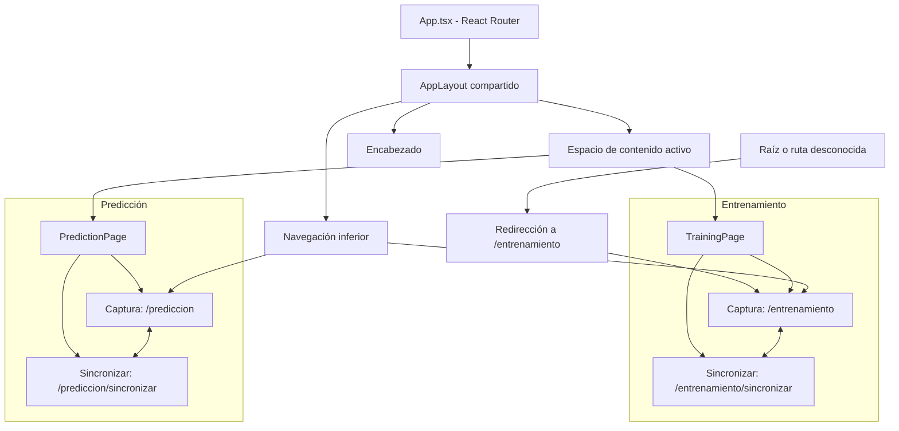

# Arquitectura de interfaz — Fase 3 (completada)

## Estado y alcance

Arquitectura aprobada e implementada. La Fase 3 está completada y validada en Android: navegación, tema claro, captura, guardado SQLite y listados locales funcionan de extremo a extremo. Las fases 1 y 2 también están completadas y SQLite está validado según confirmación del usuario.

La Fase 3 comprende navegación, tema claro, captura y consulta de registros locales. Las vistas «Sincronizar» muestran los registros locales de su tipo; el envío a FastAPI y la integración remota corresponden a la Fase 4 — Integración con FastAPI y MongoDB, pendiente de iniciar.

## 1. Inventario actual y reutilización

| Archivo | Responsabilidad actual | Uso |
|---|---|---|
| `src/main.tsx` | Monta React con `StrictMode`, `BrowserRouter` e importa `index.css`. | Entrada de la aplicación. |
| `src/App.tsx` | Declara las cuatro rutas y la redirección de rutas desconocidas. | Mapa de navegación validado. |
| `src/hooks/useSensorCapture.ts` | Encapsula la sesión, eventos, temporización y resultados. | Consumido por las vistas Captura de ambos módulos; validado. |
| `src/hooks/useCaptureSave.ts` | Coordina validación, UUID, fecha, tipo/actividad, guardado y reintento. | Guardado automático compartido; validado. |
| `src/hooks/useRecordSummaries.ts` | Consulta resúmenes por tipo, carga, error y reintento. | Listados de las vistas Sincronizar; validado. |
| `src/services/database.ts` | Inicialización y conexión compartida; validación, inserción, consulta, resúmenes y actualización SQLite. | Único servicio de persistencia para ambas páginas. Reutilizar sus siete funciones públicas. |
| `src/types/sensores.ts` | `EstadoCaptura`, `MedicionSensor`, `ResultadoCaptura` con mediciones completas. | Contratos del hook y de los componentes de captura. |
| `src/types/records.ts` | `Actividad`, `TipoRegistro`, `EstadoSync`, `Medicion`, `Registro` y `RegistroResumen`. | Contrato común para guardar y mostrar registros de ambos tipos; `Medicion` reutiliza `MedicionSensor`. |
| `src/index.css`, `src/assets/` | Estilos y recursos existentes. | Tema claro y presentación; sin un segundo sistema de temas. |

La estructura de páginas, layouts, componentes compartidos, hooks y servicios está implementada. React Router está declarado en las dependencias. No existe un servicio FastAPI en esta fase.

`DatabaseTest.tsx`, `CaptureTest.tsx` y `App.css` fueron eliminados en la tarea 3.9-A; no forman parte de la arquitectura actual.

El diseño persistente de registros sigue siendo el de [SQLITE_DESIGN.md](SQLITE_DESIGN.md); esta arquitectura no redefine su tabla ni sus restricciones. El estado actualizado de validación se registra en `WORK_STATUS.md`.

## 2. Páginas y rutas aprobadas

Hay solo **dos páginas principales**, cada una con dos vistas internas:

| Ruta | Página | Vista |
|---|---|---|
| `/entrenamiento` | `TrainingPage` | Captura |
| `/entrenamiento/sincronizar` | `TrainingPage` | Sincronizar |
| `/prediccion` | `PredictionPage` | Captura |
| `/prediccion/sincronizar` | `PredictionPage` | Sincronizar |

- `App.tsx` declara explícitamente las cuatro rutas y la redirección de cualquier ruta desconocida a `/entrenamiento`, incluyendo `/`.
- React Router es la fuente de verdad para la navegación. La vista activa procede de la ruta, evitando un estado local de pestaña que pueda contradecir la URL.
- La navegación inferior cambia entre Entrenamiento y Predicción. Los controles internos de cada página enlazan sus vistas Captura y Sincronizar.
- `AppLayout` comparte encabezado, navegación inferior y un espacio de contenido para la página/vista activa.
- Las vistas internas se componen con componentes reutilizables; no existen cuatro páginas principales ni rutas adicionales para tarjetas, resultados o pruebas técnicas.
- La integración con el historial de Android fue validada en la tarea 3.9-B. Las rutas lógicas de esta tabla son el contrato aprobado.

### Diagrama de navegación



## 3. Organización implementada

La estructura se creó progresivamente, con una responsabilidad concreta y un consumidor por archivo. No se crearon archivos vacíos ni se duplicaron servicios o tipos.

```text
src/
├── main.tsx                         # Entrada de React con BrowserRouter
├── App.tsx                          # Mapa de rutas
├── index.css                        # Tema claro y estilos compartidos
├── assets/
├── pages/
│   ├── TrainingPage.tsx             # Captura y Sincronizar de entrenamiento
│   └── PredictionPage.tsx           # Captura y Sincronizar de predicción
├── layouts/
│   └── AppLayout.tsx
├── shared/
│   ├── Header.tsx
│   └── BottomNavigation.tsx
├── components/
│   ├── capture/
│   │   ├── CaptureClock.tsx
│   │   ├── ActivitySelector.tsx
│   │   ├── CaptureControls.tsx
│   │   ├── CaptureResult.tsx
│   │   └── CaptureSaveStatus.tsx
│   └── records/
│       ├── RecordCard.tsx
│       ├── RecordList.tsx
│       └── RecordsSyncView.tsx
├── hooks/
│   ├── useAndroidBackNavigation.ts
│   ├── useCaptureSave.ts
│   ├── useRecordSummaries.ts
│   └── useSensorCapture.ts
├── services/
│   └── database.ts                  # Servicio compartido de persistencia
└── types/
    ├── sensores.ts                  # Contratos de captura
    └── records.ts                   # Contrato persistente y resúmenes
```

### Límites de responsabilidad

| Elemento | Responsabilidad | Dependencias |
|---|---|---|
| Páginas | Componer la vista correspondiente a la ruta, fijar el tipo de registro y coordinar captura, guardado y consulta. | Hook, componentes y servicio SQLite existente. |
| `AppLayout` | Estructura común y espacio de contenido activo. | Encabezado, navegación y Router; sin SQL ni listeners de sensores. |
| `shared/` | Identidad de la sección y navegación común a las dos páginas. | Rutas y estado activo de Router. |
| `components/capture/` | Mostrar tiempo, actividad y acciones mediante propiedades y callbacks. | Tipos de sensores/registros; sin conexión SQLite propia. |
| `components/records/` | Presentar listas, UUID, actividad cuando corresponda, métricas y estado de sincronización. | `Registro`, `RegistroResumen` y callbacks; sin duplicar consultas SQL. |
| Hook de captura | Suscripción a `devicemotion`, referencias, temporizadores, mediciones y resultado. | Tipos existentes y APIs del navegador; sin navegación, SQL ni red. |
| `services/database.ts` | Persistencia, validación de entrada y lectura, serialización JSON y conexión. | Plugin SQLite y tipos existentes. |
| `types/` | Contratos compartidos de sensores y registros. | Reutilizar las definiciones actuales en lugar de versiones por página. |

## 4. Reutilización entre módulos

| Comportamiento | Entrenamiento | Predicción |
|---|---|---|
| Tipo persistido | `entrenamiento` | `prediccion` |
| Actividad | Selector: `quieto`, `caminando`, `corriendo`; obligatoria para guardar. | Sin selector; `actividad: null`. |
| Captura | 10 segundos con el mismo hook. | 10 segundos con el mismo hook. |
| Presentación | Reloj y controles compartidos. | Los mismos componentes. |
| Persistencia | UUID en el dispositivo, fecha ISO, SQLite y estado inicial pendiente. | El mismo contrato y servicio. |
| Registros | Tarjetas/lista compartidas, filtradas por tipo entrenamiento. | Tarjetas/lista compartidas, filtradas por tipo predicción. |
| Sincronización | Interfaz local; envío real pendiente de Fase 4. | Interfaz local; envío real pendiente de Fase 4. |

`ActivitySelector` solo se monta en entrenamiento. El reloj, los controles, las tarjetas y los listados no se duplican por módulo: reciben datos y acciones apropiados mediante propiedades. Compartir el hook significa compartir implementación; no implica un estado global de captura ni dos suscripciones activas simultáneas.

## 5. Relación entre captura, páginas y SQLite

Flujo implementado:

1. La página determina `TipoRegistro` y, para entrenamiento, recoge `Actividad`.
2. Los controles invocan el hook; el reloj representa su progreso. El hook recibe `devicemotion` y produce mediciones y métricas.
3. `useCaptureSave` construye un `Registro` con UUID generado en Android, fecha ISO UTC y estado `pendiente`.
4. `saveRecord` valida y persiste utilizando la conexión existente. La interfaz muestra confirmación solo después del éxito y presenta cualquier error sin simular un guardado.
5. Las vistas Sincronizar consultan `getRecordSummaries(tipo)` y reutilizan `RecordList`/`RecordCard`. La consulta filtra por tipo y calcula la cantidad de mediciones con `json_array_length()`.
6. `getRecordById` permite recuperar el registro cuando sea necesario. La sincronización de Fase 4 usará `markAsSynced` únicamente tras confirmación remota; esta función por sí sola no envía datos.

La base se inicializa con el servicio actual; sus operaciones solicitan la inicialización cuando es necesaria. Las páginas no crean conexiones SQLite.

### Interfaz del hook extraído — validada

`useSensorCapture()` devuelve `estado: EstadoCaptura`, `segundos: number`, `resultado: ResultadoCaptura | null` e `iniciar(): void`. Conserva los 10000 ms objetivo, la comprobación cada 100 ms, `performance.now()`, los seis valores, los conteos y la frecuencia `total / duración real`. Las vistas Captura de `TrainingPage` y `PredictionPage` son los consumidores actuales.

`iniciar` ignora llamadas si su instancia ya captura o está desmontada. Listener e intervalo pertenecen a la sesión y se retiran al finalizar o desmontar, limpiando referencias temporales. Al desmontar no se publica resultado parcial. El contrato exige un solo consumidor activo; no se introduce un gestor global de sesiones entre múltiples instancias.

`ResultadoCaptura` se amplió únicamente con `mediciones: MedicionSensor[]`: instantánea completa, sin filtrar muestras, publicada al terminar. El búfer no se expone durante la captura. El resultado se conserva hasta iniciar la siguiente sesión o desmontar; no constituye historial ni guardado SQLite. No se expone parada anticipada para conservar la captura automática de 10 segundos.

Duración y frecuencia se muestran como cadenas con dos decimales, mientras `Registro` exige números y duración en milisegundos. La integración del guardado usa las magnitudes numéricas originales; el formato de pantalla no es la fuente de datos persistidos.

La captura contabiliza muestras incompletas y SQLite rechaza lecturas nulas/no finitas. La implementación actual no guarda capturas con muestras incompletas y muestra un estado de error para repetir la captura; no se relajan las restricciones de SQLite.

La cuenta regresiva de 3 segundos está implementada antes de la captura de 10 segundos y no forma parte de su duración ni frecuencia. La navegación durante preparación/captura desmonta la vista y limpia recursos sin guardar capturas parciales; esta política fue validada en Android.

## 6. Tema visual aprobado

Solo tema claro. Sin modo oscuro ni selector de temas.

La fuente oficial de colores, tipografía, espaciados y estilos es el documento original de Google Stitch: [docs/design/DESIGN.md](design/DESIGN.md). Consultarlo directamente para los valores y reglas visuales; esta arquitectura no mantiene una copia del sistema completo de estilos.

Las capturas de las cuatro vistas se encuentran en [docs/design/references/](design/references/):

| Vista | Captura disponible |
|---|---|
| Entrenamiento — Captura | [entrenamiento-captura.png](design/references/entrenamiento_captura/entrenamiento-captura.png) |
| Entrenamiento — Sincronizar | [ntrenamiento-sincronizar.png](design/references/entrenamiento_sincronizar/ntrenamiento-sincronizar.png) |
| Predicción — Captura | [prediccion-captura.png](design/references/predicci_n_captura/prediccion-captura.png) |
| Predicción — Sincronizar | [prediccion-sincronizar.png](design/references/predicci_n_sincronizar/prediccion-sincronizar.png) |

Los enlaces conservan los nombres reales de los archivos entregados. Cada carpeta contiene también un `code.html` de referencia; estos recursos visuales no cambian las rutas, los componentes ni el alcance funcional aprobados.

### Prioridad de la paleta y normalización del YAML

Por decisión definitiva, la sección **«Colors / Functional Palette» tiene prioridad** sobre los valores contradictorios del YAML de `DESIGN.md`. Para texto sobre verde se mantiene el blanco `#FFFFFF` aprobado, también indicado en los estilos de botones del documento. Esta regla resuelve la discrepancia de precedencia y conserva `DESIGN.md` como fuente oficial.

Se corrigieron únicamente los tokens con equivalencia semántica clara:

| Token YAML | Valor anterior | Valor aprobado | Responsabilidad |
|---|---|---|---|
| `background` | `#E9FFEE` | `#F5F8F5` | Fondo principal |
| `surface` | `#E9FFEE` | `#FFFFFF` | Superficie base; se distingue del fondo principal |
| `primary` | `#006A38` | `#16854B` | Verde principal |
| `on-background` | `#0A2014` | `#172C20` | Texto principal sobre el fondo |
| `on-surface` | `#0A2014` | `#172C20` | Texto principal sobre superficies |

`surface-container-lowest` y `on-primary` ya usan `#FFFFFF`; `primary-container` ya contiene `#16854B`. No necesitaron cambios de valor.

**Tokens adicionales pendientes de interpretación si se utilizan:** se conservan las variantes `surface-dim`, `surface-bright`, `surface-variant`, la escala `surface-container-*`, `surface-tint`, `on-surface-variant`, los roles de contenedor y sus textos, y las familias secundarias, terciarias, inversas y fijas. La paleta funcional no establece una correspondencia completa para esos roles. En particular, `on-surface-variant: #3E4940` no se considera una equivalencia confirmada del texto secundario `#506557`, ni se convierte automáticamente un contenedor en el verde suave `#E4F3E9`. Los colores de error y contorno también se conservan como roles adicionales, sin reinterpretar reglas de bordes o avisos.

Para los usos aprobados de verde suave, texto secundario y texto sobre verde, aplicar respectivamente `#E4F3E9`, `#506557` y `#FFFFFF`, conforme a la paleta y las reglas del cuerpo del documento; no sustituirlos por un token adicional solo por su nombre. La base visual de la Fase 3 está implementada y validada. Interpretar un rol adicional será necesario solo si se decide utilizarlo, sin desplazar la paleta prioritaria ni ampliar el alcance funcional.

El documento original y las cuatro capturas están disponibles. El tema claro está implementado y validado en Android; las pruebas temporales con estilos oscuros fueron retiradas en 3.9-A.

## 7. Implementación y verificación

La Fase 3 quedó implementada y validada. Orden ejecutado:

1. Hook de captura extraído y validado conservando el comportamiento de 10 segundos.
2. React Router, dos páginas y `AppLayout` con navegación funcional.
3. Paleta clara y componentes visuales comunes siguiendo Stitch.
4. Reloj, controles reutilizables y selector exclusivo de entrenamiento.
5. Cuenta regresiva de 3 segundos y política de navegación durante la captura.
6. Guardado de ambos tipos con el servicio y contrato existentes.
7. Vistas Sincronizar con listados locales por tipo y estados de carga, vacío y error. El envío remoto queda para la Fase 4 y no marca registros como sincronizados.
8. Validación integral en Android y limpieza de pruebas temporales (3.9-A y 3.9-B).

Las verificaciones de tipos, lint, build y Android fueron ejecutadas manualmente por el usuario. La validación integral confirmó las cuatro rutas, la navegación, el botón Atrás, la captura, el guardado, los listados, la persistencia y el funcionamiento sin conexión. Los sensores y SQLite requieren dispositivo real; navegación y estilos pueden revisarse en web sin simular persistencia SQLite.

## 8. Cierre de la Fase 3 y siguiente etapa

La Fase 3 está finalizada. La limpieza 3.9-A retiró `DatabaseTest`, `CaptureTest`, sus estilos exclusivos y `App.css`. La validación 3.9-B confirmó en Android el flujo completo de Entrenamiento y Predicción, la persistencia y el funcionamiento sin internet. No se modificó el esquema SQLite ni se implementó sincronización remota.

La siguiente etapa es la Fase 4 — Integración con FastAPI y MongoDB, pendiente de iniciar. `markAsSynced` seguirá reservado para confirmar la sincronización remota.
