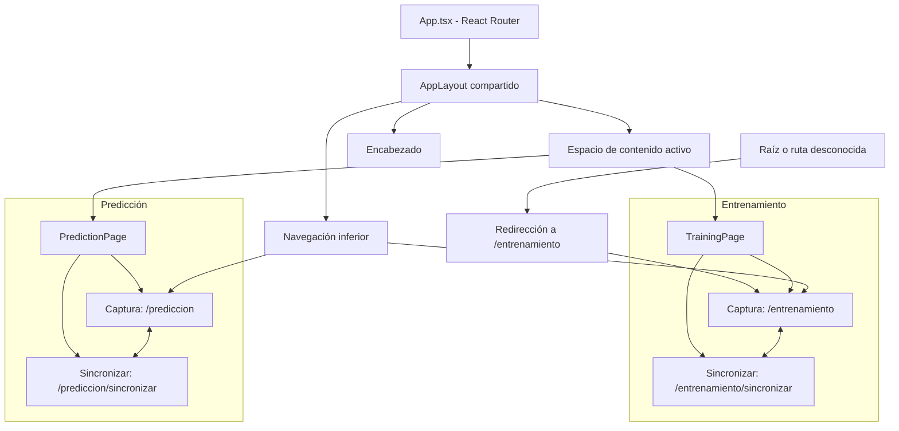

# Arquitectura de interfaz — Fase 3

## Estado y alcance

Arquitectura aprobada. La extracción del hook de la tarea 3.1 está implementada y pendiente de validación manual en Android; rutas, páginas e interfaz definitiva siguen pendientes. Las fases 1 y 2 están completadas y SQLite está validado según confirmación del usuario.

La Fase 3 comprende navegación, tema claro, captura y consulta de registros locales. Las vistas «Sincronizar» preparan la interfaz de sincronización manual; el envío a FastAPI y la integración remota corresponden a la Fase 4.

## 1. Inventario actual y reutilización

| Archivo existente | Responsabilidad actual | Uso previsto |
|---|---|---|
| `src/main.tsx` | Monta React con `StrictMode` e importa `index.css`. | Conservar como entrada; conectar el proveedor de React Router cuando se implemente la navegación. |
| `src/App.tsx` | Consume `useSensorCapture` y presenta la prueba actual; incluye `DatabaseTest`. | Pasar posteriormente a definir las rutas permitidas. |
| `src/hooks/useSensorCapture.ts` | Encapsula la sesión, eventos, temporización y resultados; pendiente de validación de la extracción. | Reutilizar en las futuras páginas con un solo consumidor de captura activo. |
| `src/components/DatabaseTest.tsx` | Prueba temporal de SQLite con datos sintéticos y consulta por UUID. | Mantener como referencia de validación durante la transición; no convertirlo en una tercera página ni copiar su lógica a cada módulo. |
| `src/services/database.ts` | Inicialización y conexión compartida; validación, inserción, consulta y actualización SQLite. | Único servicio de persistencia para ambas páginas. Reutilizar sus seis funciones públicas. |
| `src/types/sensores.ts` | `EstadoCaptura`, `MedicionSensor`, `ResultadoCaptura` con mediciones completas. | Contratos del hook y de los futuros componentes de captura. |
| `src/types/records.ts` | `Actividad`, `TipoRegistro`, `EstadoSync`, `Medicion`, `Registro`. | Contrato común para guardar y mostrar registros de ambos tipos; `Medicion` ya reutiliza `MedicionSensor`. |
| `src/index.css`, `src/App.css`, `src/assets/` | Estilos y recursos existentes; `App.tsx` también tiene estilos en línea. | Revisar su uso al aplicar el tema claro, sin crear un segundo sistema de temas. |

Actualmente existe `hooks/useSensorCapture.ts`; no existen `pages/`, `layouts/`, `shared/` ni las subcarpetas de componentes propuestas. React Router no aparece en las dependencias declaradas. No existe un servicio FastAPI.

El diseño persistente de registros sigue siendo el de [SQLITE_DESIGN.md](SQLITE_DESIGN.md); esta arquitectura no redefine su tabla ni sus restricciones. El estado actualizado de validación se registra en `WORK_STATUS.md`.

## 2. Páginas y rutas aprobadas

Solo habrá **dos páginas principales**, cada una con dos vistas internas:

| Ruta | Página | Vista |
|---|---|---|
| `/entrenamiento` | `TrainingPage` | Captura |
| `/entrenamiento/sincronizar` | `TrainingPage` | Sincronizar |
| `/prediccion` | `PredictionPage` | Captura |
| `/prediccion/sincronizar` | `PredictionPage` | Sincronizar |

- `App.tsx` declarará explícitamente las cuatro rutas y la redirección de cualquier ruta desconocida a `/entrenamiento`, incluyendo `/`.
- React Router será la fuente de verdad para la navegación. La vista activa procederá de la ruta, evitando un estado local de pestaña que pueda contradecir la URL.
- La navegación inferior cambiará entre Entrenamiento y Predicción. Los controles internos de cada página enlazarán sus vistas Captura y Sincronizar.
- `AppLayout` compartirá encabezado, navegación inferior y un espacio de contenido para la página/vista activa, que podrá materializarse mediante `Outlet` al implementar las rutas.
- Las vistas internas podrán componerse con componentes reutilizables; no se crearán cuatro páginas principales ni rutas adicionales para tarjetas, resultados o pruebas técnicas.
- La elección del proveedor de Router y los detalles de integración con el historial de Android se verificarán al implementar la navegación. Las rutas lógicas de esta tabla son el contrato aprobado.

### Diagrama de navegación



## 3. Organización propuesta

Los nombres de componentes auxiliares son propuestas de implementación. El hook `useSensorCapture` ya está extraído, pendiente de validación. El resto se creará progresivamente, cuando tenga una responsabilidad concreta y un consumidor; no se crearán archivos vacíos.

```text
src/
├── main.tsx                         # Existente: entrada de React
├── App.tsx                          # Existente: futuro mapa de rutas
├── index.css                        # Existente: futura base del tema claro
├── App.css                          # Existente: revisar su uso al aplicar estilos
├── assets/                          # Existente
├── pages/                           # Propuesto
│   ├── TrainingPage.tsx             # Captura y Sincronizar de entrenamiento
│   └── PredictionPage.tsx           # Captura y Sincronizar de predicción
├── layouts/                         # Propuesto
│   └── AppLayout.tsx
├── shared/                          # Propuesto: elementos comunes de navegación
│   ├── Header.tsx
│   └── BottomNavigation.tsx
├── components/
│   ├── DatabaseTest.tsx             # Existente: prueba temporal
│   ├── capture/                     # Propuesto
│   │   ├── CaptureClock.tsx
│   │   ├── ActivitySelector.tsx
│   │   └── CaptureControls.tsx
│   ├── records/                     # Propuesto
│   │   ├── RecordCard.tsx
│   │   └── RecordList.tsx
│   └── ui/                          # Propuesto: botones e indicadores genéricos
├── hooks/                           # Existente: extracción pendiente de validar
│   └── useSensorCapture.ts
├── services/
│   └── database.ts                  # Existente: conservar servicio compartido
└── types/
    ├── sensores.ts                  # Existente: reutilizar contratos de captura
    └── records.ts                   # Existente: reutilizar contrato persistente
```

### Límites de responsabilidad

| Elemento | Responsabilidad | Dependencias previstas |
|---|---|---|
| Páginas | Componer la vista correspondiente a la ruta, fijar el tipo de registro y coordinar captura, guardado y consulta. | Hook, componentes y servicio SQLite existente. |
| `AppLayout` | Estructura común y espacio de contenido activo. | Encabezado, navegación y Router; sin SQL ni listeners de sensores. |
| `shared/` | Identidad de la sección y navegación común a las dos páginas. | Rutas y estado activo de Router. |
| `components/capture/` | Mostrar tiempo, actividad y acciones mediante propiedades y callbacks. | Tipos de sensores/registros; sin conexión SQLite propia. |
| `components/records/` | Presentar listas, UUID, actividad cuando corresponda, métricas y estado de sincronización. | `Registro` y callbacks; sin duplicar consultas SQL. |
| `components/ui/` | Botones, indicadores y elementos visuales independientes del dominio. | Propiedades de presentación y accesibilidad. |
| Hook de captura | Suscripción a `devicemotion`, referencias, temporizadores, mediciones y resultado. | Tipos existentes y APIs del navegador; sin navegación, SQL ni red. |
| `services/database.ts` | Persistencia, validación de entrada y lectura, serialización JSON y conexión. | Plugin SQLite y tipos existentes. |
| `types/` | Contratos compartidos de sensores y registros. | Reutilizar las definiciones actuales en lugar de versiones por página. |

## 4. Reutilización entre módulos

| Comportamiento | Entrenamiento | Predicción |
|---|---|---|
| Tipo persistido | `entrenamiento` | `prediccion` |
| Actividad | Selector: `quieto`, `caminando`, `corriendo`; obligatoria para guardar. | Sin selector; `actividad: null`. |
| Captura | 10 segundos con el mismo hook. | 10 segundos con el mismo hook. |
| Presentación | Reloj y controles compartidos. | Los mismos componentes. |
| Persistencia | UUID en el dispositivo, fecha ISO, SQLite y estado inicial pendiente. | El mismo contrato y servicio. |
| Registros | Tarjetas/lista compartidas, filtradas por tipo entrenamiento. | Tarjetas/lista compartidas, filtradas por tipo predicción. |
| Sincronización | Manual, desde su vista interna. | Manual, desde su vista interna. |

`ActivitySelector` solo se monta en entrenamiento. El reloj, los controles, las tarjetas y los listados no se duplican por módulo: reciben datos y acciones apropiados mediante propiedades. Compartir el hook significa compartir implementación; no implica un estado global de captura ni dos suscripciones activas simultáneas.

## 5. Relación entre captura, páginas y SQLite

Flujo previsto:

1. La página determina `TipoRegistro` y, para entrenamiento, recoge `Actividad`.
2. Los controles invocan el hook; el reloj representa su progreso. El hook recibe `devicemotion` y produce mediciones y métricas.
3. Al guardar, la coordinación de la página construye un `Registro` con UUID generado en Android, fecha ISO UTC y estado `pendiente`.
4. `saveRecord` valida y persiste utilizando la conexión existente. La página muestra confirmación solo después del éxito y presenta cualquier error sin simular un guardado.
5. Las vistas Sincronizar consultan `getRecords` o `getPendingRecords`, filtran por `tipo` y reutilizan `RecordList`/`RecordCard`. Las funciones actuales consultan ambos tipos; no se propondrá otra base ni otro servicio para separarlos.
6. `getRecordById` permite recuperar el registro cuando sea necesario. La futura sincronización de Fase 4 usará `markAsSynced` únicamente tras confirmación remota; esta función por sí sola no envía datos.

La base se inicializa con el servicio actual; sus operaciones ya solicitan la inicialización cuando es necesaria. Las páginas no crean conexiones SQLite.

### Interfaz del hook extraído — tarea 3.1 pendiente de validar

`useSensorCapture()` devuelve `estado: EstadoCaptura`, `segundos: number`, `resultado: ResultadoCaptura | null` e `iniciar(): void`. Conserva los 10000 ms objetivo, la comprobación cada 100 ms, `performance.now()`, los seis valores, los conteos y la frecuencia `total / duración real`. App mantiene la prueba actual como consumidor.

`iniciar` ignora llamadas si su instancia ya captura o está desmontada. Listener e intervalo pertenecen a la sesión y se retiran al finalizar o desmontar, limpiando referencias temporales. Al desmontar no se publica resultado parcial. El contrato exige un solo consumidor activo; no se introduce un gestor global de sesiones entre múltiples instancias.

`ResultadoCaptura` se amplió únicamente con `mediciones: MedicionSensor[]`: instantánea completa, sin filtrar muestras, publicada al terminar. El búfer no se expone durante la captura. El resultado se conserva hasta iniciar la siguiente sesión o desmontar; no constituye historial ni guardado SQLite. No se expone parada anticipada para conservar la captura automática de 10 segundos.

Duración y frecuencia siguen siendo cadenas con dos decimales para presentación, mientras `Registro` exige números y duración en milisegundos. La integración futura del guardado deberá exponer las magnitudes numéricas originales; el formato de pantalla no será la fuente de datos persistidos.

La captura actual contabiliza muestras incompletas y SQLite rechaza lecturas nulas/no finitas. Antes de conectar el guardado se debe acordar cómo informar y tratar una sesión con muestras incompletas; no se asumirá un filtrado silencioso ni se relajarán las restricciones de SQLite.

La cuenta regresiva de 3 segundos ya prevista en el roadmap se implementará después de verificar la extracción: precede a los 10 segundos de captura y no forma parte de su duración ni de su frecuencia. La política de navegación durante cuenta regresiva/captura deberá definirse antes de activar esos flujos, garantizando limpieza de recursos y sin guardados parciales automáticos.

## 6. Tema visual aprobado

Solo tema claro. Sin modo oscuro ni selector de temas.

La fuente oficial de colores, tipografía, espaciados y estilos para la implementación futura es el documento original de Google Stitch: [docs/design/DESIGN.md](design/DESIGN.md). Consultarlo directamente para los valores y reglas visuales; esta arquitectura no mantiene una copia del sistema completo de estilos.

Las capturas de las cuatro vistas se encuentran en [docs/design/references/](design/references/):

| Vista | Captura disponible |
|---|---|
| Entrenamiento — Captura | [entrenamiento-captura.png](design/references/entrenamiento_captura/entrenamiento-captura.png) |
| Entrenamiento — Sincronizar | [ntrenamiento-sincronizar.png](design/references/entrenamiento_sincronizar/ntrenamiento-sincronizar.png) |
| Predicción — Captura | [prediccion-captura.png](design/references/predicci_n_captura/prediccion-captura.png) |
| Predicción — Sincronizar | [prediccion-sincronizar.png](design/references/predicci_n_sincronizar/prediccion-sincronizar.png) |

Los enlaces conservan los nombres reales de los archivos entregados. Cada carpeta contiene también un `code.html` de referencia; estos recursos visuales no cambian las rutas, los componentes ni el alcance funcional aprobados.

### Prioridad de la paleta y normalización del YAML

Por decisión definitiva, la sección **«Colors / Functional Palette» tiene prioridad** sobre los valores contradictorios del YAML de `DESIGN.md`. Para texto sobre verde se mantiene el blanco `#FFFFFF` aprobado, también indicado en los estilos de botones del documento. Esta regla resuelve la discrepancia de precedencia y conserva `DESIGN.md` como fuente oficial.

Se corrigieron únicamente los tokens con equivalencia semántica clara:

| Token YAML | Valor anterior | Valor aprobado | Responsabilidad |
|---|---|---|---|
| `background` | `#E9FFEE` | `#F5F8F5` | Fondo principal |
| `surface` | `#E9FFEE` | `#FFFFFF` | Superficie base; se distingue del fondo principal |
| `primary` | `#006A38` | `#16854B` | Verde principal |
| `on-background` | `#0A2014` | `#172C20` | Texto principal sobre el fondo |
| `on-surface` | `#0A2014` | `#172C20` | Texto principal sobre superficies |

`surface-container-lowest` y `on-primary` ya usan `#FFFFFF`; `primary-container` ya contiene `#16854B`. No necesitaron cambios de valor.

**Tokens adicionales pendientes de interpretación si se utilizan:** se conservan las variantes `surface-dim`, `surface-bright`, `surface-variant`, la escala `surface-container-*`, `surface-tint`, `on-surface-variant`, los roles de contenedor y sus textos, y las familias secundarias, terciarias, inversas y fijas. La paleta funcional no establece una correspondencia completa para esos roles. En particular, `on-surface-variant: #3E4940` no se considera una equivalencia confirmada del texto secundario `#506557`, ni se convierte automáticamente un contenedor en el verde suave `#E4F3E9`. Los colores de error y contorno también se conservan como roles adicionales, sin reinterpretar reglas de bordes o avisos.

Para los usos aprobados de verde suave, texto secundario y texto sobre verde, aplicar respectivamente `#E4F3E9`, `#506557` y `#FFFFFF`, conforme a la paleta y las reglas del cuerpo del documento; no sustituirlos por un token adicional solo por su nombre. La base visual queda lista para la Fase 3. Interpretar un rol adicional será necesario solo si se decide utilizarlo, sin desplazar la paleta prioritaria ni ampliar el alcance funcional.

El documento original y las cuatro capturas ya están disponibles. El tema claro sigue pendiente de implementación; la prueba actual aún contiene estilos oscuros en línea.

## 7. Implementación progresiva y verificación

La lista verificable se mantiene en la Fase 3 de `ROADMAP.md`. Orden recomendado:

1. Extraer y validar el hook conservando la prueba actual.
2. Incorporar React Router, dos páginas y `AppLayout` con navegación funcional.
3. Aplicar la paleta clara y componentes visuales comunes siguiendo Stitch.
4. Integrar reloj, controles reutilizables y selector exclusivo de entrenamiento.
5. Añadir la cuenta regresiva y acordar el comportamiento al navegar durante una captura.
6. Conectar el guardado de ambos tipos con el servicio y contrato existentes, resolviendo métricas y muestras incompletas.
7. Construir las vistas Sincronizar con listados locales por tipo y estados de carga, vacío y error. Hasta Fase 4, el envío remoto debe indicarse como no disponible y no marcar registros como sincronizados.
8. Validar navegación, captura y persistencia offline en Android y retirar la sección temporal de la interfaz principal cuando el flujo definitivo equivalente esté comprobado.

Para cada tarea de código, el usuario ejecutará manualmente las verificaciones de tipos, lint y build, y la sincronización/prueba Android cuando corresponda. Deben verificarse las cuatro rutas, el acceso a rutas desconocidas, el historial y el botón Atrás en Android; los sensores y SQLite requieren dispositivo real. Navegación y estilos pueden revisarse en web sin simular persistencia SQLite.

## 8. Primera tarea recomendada

**Extraer la lógica de captura de `App.tsx` a `hooks/useSensorCapture.ts` conservando el comportamiento actual.** Extracción implementada; pendiente de verificaciones manuales y confirmación del usuario en Android antes de continuar con navegación.

Alcance acotado: mover responsabilidades de sensores y temporización, reutilizar tipos actuales y mantener `App.tsx` como interfaz de prueba. Sin Router, rediseño, cuenta regresiva ni guardado de capturas reales en esa primera extracción.

Criterio de cierre: tipos/lint/build correctos y captura repetible de 10 segundos en Xiaomi 11T, métricas equivalentes al comportamiento previo, una sola suscripción activa y limpieza al desmontar. La frecuencia se mide; no se exige repetir exactamente 601 muestras ni 60.09 Hz.
